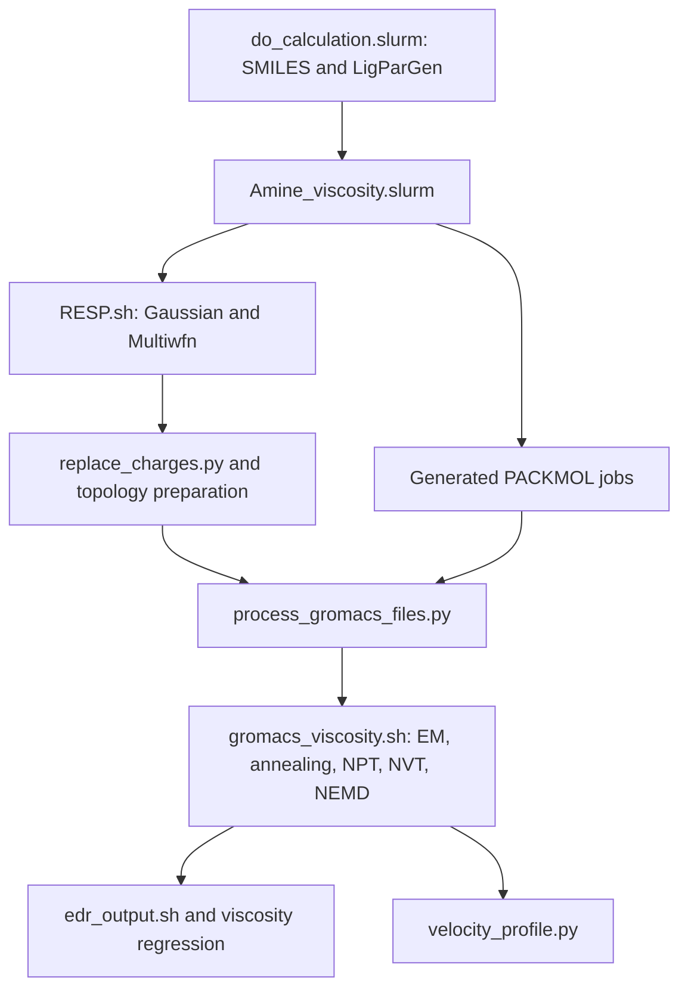

# Molecular simulation source programs

Source programs for preparing molecular inputs, submitting GROMACS viscosity simulations and analysing their outputs. The package contains the programs that generate the per-loading and per-acceleration jobs, their shared Python/Bash dependencies, and the small molecular inputs for directory 21 (EEMPA).

## Download and inspect

Download [simulation-source-programs-20261028.zip](simulation-source-programs-20261028.zip) and extract it. `SOURCE_INDEX.csv` identifies each original source file and its role; `SOURCE_MANIFEST.json` records its SHA-256. Original source programs are preserved without numerical or algorithmic edits. The four entry scripts shown alongside this guide are reading copies; use the archive to obtain the complete directory structure.

The generated `packmol_*.slurm`, `gromacs_*.slurm`, `submit_*.sh`, per-loading MDP files and other job instances are intentionally absent: their parent programs generate them. Trajectories, restart files, energy binaries, rendered images and large coordinate files are also absent.

## Program hierarchy



| Entry or directory | Purpose |
|---|---|
| `Viscosity_cal/do_calculation.slurm` | Reads the SMILES workbook, runs LigParGen, copies the shared source library and submits the molecular workflow. |
| `Viscosity_cal/script/` | Shared source library used by that batch entry. |
| `Viscosity_cal/21/Amine_viscosity.slurm` | Starts directly from the supplied molecular PDB/ITP files; generates RESP, topology, PACKMOL and GROMACS jobs. |
| `Viscosity_cal/21/gromacs_viscosity.sh` | Directory-21 driver, including generated MDP and viscosity/postprocessing jobs. |
| `dataprocess/` | Recursively resolved shared helpers for charges, topology, convergence plots, viscosity and velocity profiles. |
| `Viscosity_cal/21/post_analysis.slurm` | Separate analysis entry for density, free volume, hydrogen bonds and summary plots. It is not invoked automatically by the directory-21 main driver. |
| `Viscosity_cal/21/process_rdf*.slurm` | Separate RDF and coordination analysis entries; plotting helpers are supplied in their referenced subdirectories. |
| `reference_charges/` | Small saved RESP charge files, supplied as reference inputs rather than silently used to skip a new charge calculation. |

The shared library and directory 21 are **distinct versions**. Directory 21 uses six fixed acceleration amplitudes, 0.025–0.050 nm ps−2. The shared library contains an adaptive regression loop and currently starts with nine amplitudes, 0.005–0.045 nm ps−2. The older HTML overview describes another configuration and is not an authoritative parameter record. `variants/gromacs_viscosity_from_run_directory.sh` preserves the distinct run-directory copy; its energy-menu parsing and job-ID handling differ from the top-level directory-21 copy.

## Prepare a working copy

On a Linux system, use Python 3 to create a separate copy with the author-specific project paths relocated:

```bash
python prepare_paths.py --output /scratch/myproject --runtime-root /scratch/myproject
```

This operation copies files and configures paths only. It does not submit jobs, alter scientific settings, overwrite an existing directory or install software. `PATH_CONFIGURATION.json` records the substitutions. The original archive remains unchanged.

Before submitting, set your Slurm partition/resources, MPI configuration and software initialization paths. Review any stored numeric Slurm dependency in an optional analysis entry; it refers to a historical scheduler job and must be replaced with dependencies from the new run.

Two starting points are available:

* To inspect or adapt the directory-21 workflow, work in `Viscosity_cal/21/` and use `Amine_viscosity.slurm` after checking the restart requirements below.
* To generate inputs from SMILES with the shared library, work in `Viscosity_cal/` and use `do_calculation.slurm 21`. This entry copies `script/*` into `21/`, replacing its driver files; use a separate working copy for this route. The example workbook contains only system 21 and the four columns consumed by the script.

Both are three-species carbamate/protonated-amine models with 2000 total molecules and nine CO2 loadings. Other chemistries require their own structures, topologies and molecular-count rules.

## Software and run state

The scripts call Bash, Slurm, MPI-enabled GROMACS (`gmx_mpi`), PACKMOL, Gaussian (`g16` or `g09`), `formchk`, Multiwfn and standard Unix tools including `bc`, `awk`, `sed`, `grep` and `timeout`. SMILES-based input generation also calls LigParGen. The shared driver contains a site-specific GROMACS 2024.4 environment path and an MPI PMI-library path; configure these for the target cluster. External scientific programs and their licences are not bundled.

Python imports include NumPy, SciPy, Matplotlib, pandas, openpyxl, Pillow, NetworkX, seaborn and RDKit; particular optional scripts can need further imports listed in their source. This source snapshot does not establish a historically exact Python dependency environment.

The directory-21 annealing branch references an existing `NVT_313.gro` when no checkpoint is present. It is therefore not a verified fresh-start driver without adaptation or the required prior state. The shared driver has a separate fresh-start branch. Neither source version has been rerun through a full molecular-dynamics calculation as part of this deposit.

The original velocity-profile postprocessing removes the NEMD trajectory after generating its plot. Review that retention behaviour before a new run if later trajectory analyses are needed.

## Connection to the reported results

The energy helper extracts inverse viscosity over 200–450 ps of the 500 ps production run. Velocity-profile visualization uses 350–450 ps. These are separate operations. The directory-21 regression is performed against acceleration itself; the legacy uncertainty expression is not the conditional intercept standard error used in the current numerical release.

For the reported numerical estimates and their adopted uncertainty definitions, use the repository's [versioned numerical data and analysis](https://github.com/Nemo-ZJU-1998/Water-Lean-Absorbent-Viscosity/releases/tag/data-20261028-v2). Do not substitute the legacy regression uncertainty, default free-volume analysis or another molecular model for the adopted analyses.

`VALIDATION.json` reports source syntax and isolated job-generation checks. These checks demonstrate that the source dependencies are supplied and the main entry generates its jobs; they do not establish complete MD reproducibility or bitwise-identical trajectories.
